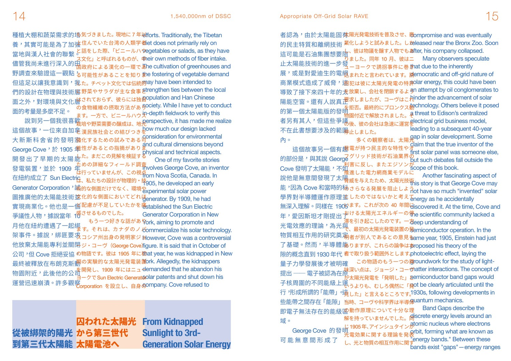
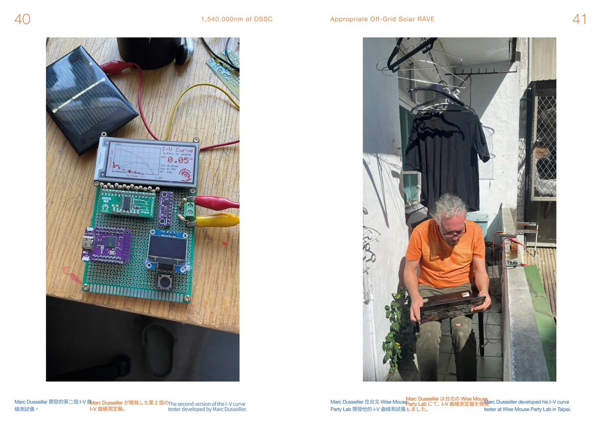
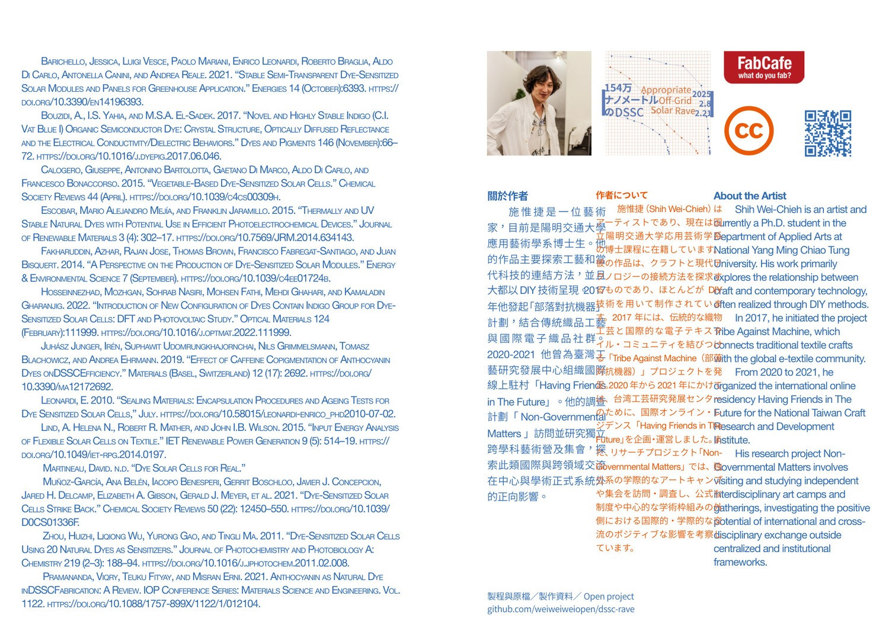
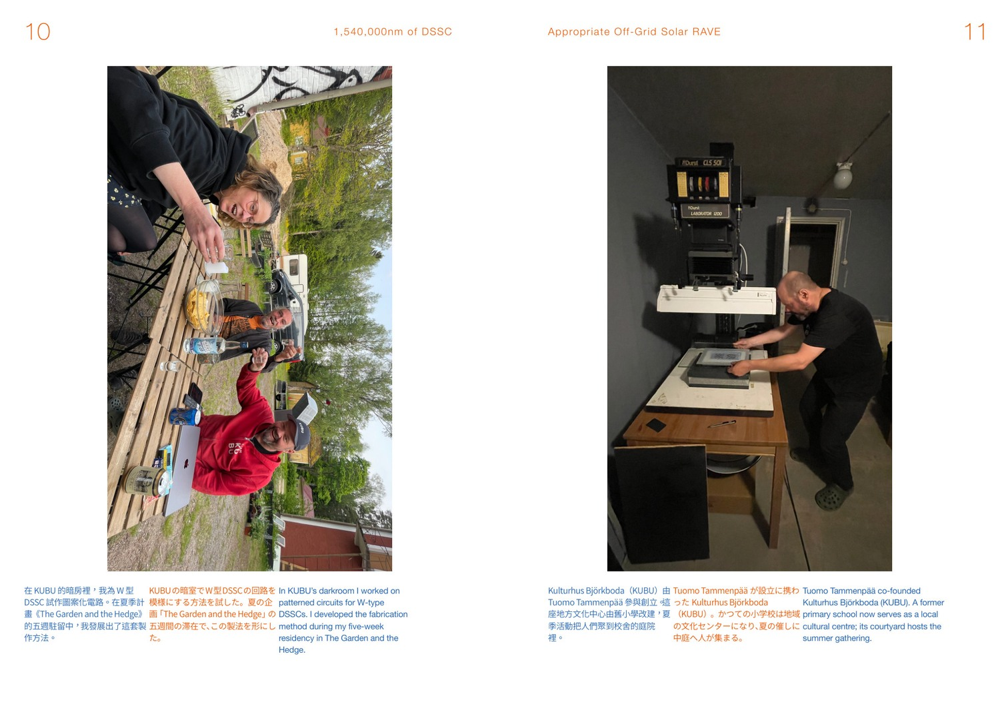
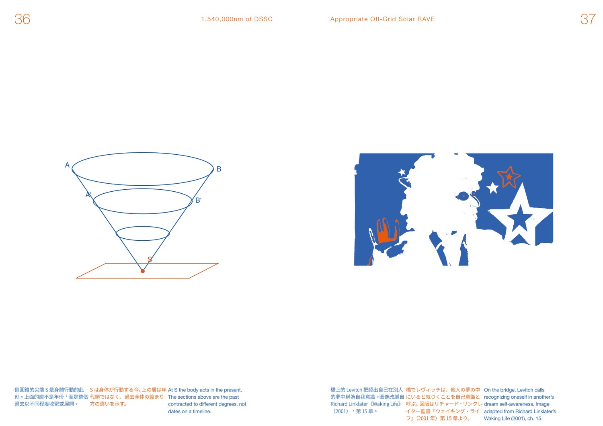

# 1,540,000nm of DSSC, Appropriate Off-Grid Solar RAVE

## The trilingual zines

Shih Wei-Chieh (Abao) · Chinese, English and Japanese · 104 × 147 mm

### Volume 1: 1,540,000nm of DSSC — 84 pages

The story begins in a greenhouse and moves to the workbench. How do two pieces of conductive glass become a dye-sensitized solar cell (DSSC)? Follow the glass through dyeing, sealing and wiring, then listen to the sound its electricity can produce.

[Browse the pages](book/vol-1/pages/) · [Download the editable DesignCraft file](https://raw.githubusercontent.com/weiweiweiopen/dssc-rave/main/book/vol-1/DSSC-Vol-1.designcraft) · [Browse the source artwork](book/vol-1/source-files/)

### Volume 2: Reading the Same Piece of Glass Again — 58 pages

If I move the lamp, or take a handmade cell out of its clamp and put it back, can the reader still recognize it? The current–voltage curves on my workbench lead to a question about the Solar Oracle Walkman: even if an agent recognizes the glass and remembers the music, who gives it permission to play?

[Browse the pages](book/vol-2/pages/) · [Download the editable DesignCraft file](https://raw.githubusercontent.com/weiweiweiopen/dssc-rave/main/book/vol-2/DSSC-Vol-2.designcraft) · [Browse the source artwork](book/vol-2/source-files/)

Both DesignCraft files contain the artwork needed to open the book. In each volume, `pages/` contains 240 dpi reading images in page order, including the blank back cover. Use `source-files/` to replace individual images or diagrams. Before editing the layout, install licensed copies of Helvetica Neue, the Traditional Chinese and Japanese Noto Sans families, and Kozuka Gothic Pr6N. The books and illustrations retain their original credits and licenses.

Shih Wei-Chieh (Abao) · dye-sensitized solar glass, off-grid sound and a trilingual zine.

- [Fabrication and measurement](docs/fabrication.md) — baseline module and experimental variants, with source and reproducibility status.
- [Solar audio and RAVE](docs/audio.md) — signal paths and repeatable comparison procedure.
- [Bill of materials and dated price checks](materials/quotes.csv) · [pricing notes](materials/README.md).
- [Run sheet](templates/build-log.csv) · [I–V analysis](tools/iv.py).

The baseline is the documented 30 × 60 cm, 12-subcell Z-series glass prototype. Experimental variants are listed separately. This release documents a reproduction path; it does not claim independent reproduction or completeness where original masks, batches, waveforms, or settings are not available. Please contribute a filled build log and raw data when repeating a build.

The new guides, price data and templates are available under [CC BY 4.0](https://creativecommons.org/licenses/by/4.0/); the original booklet, artwork, and linked upstream assets retain their respective credits and terms. The analysis script is MIT-licensed as indicated in its source.
