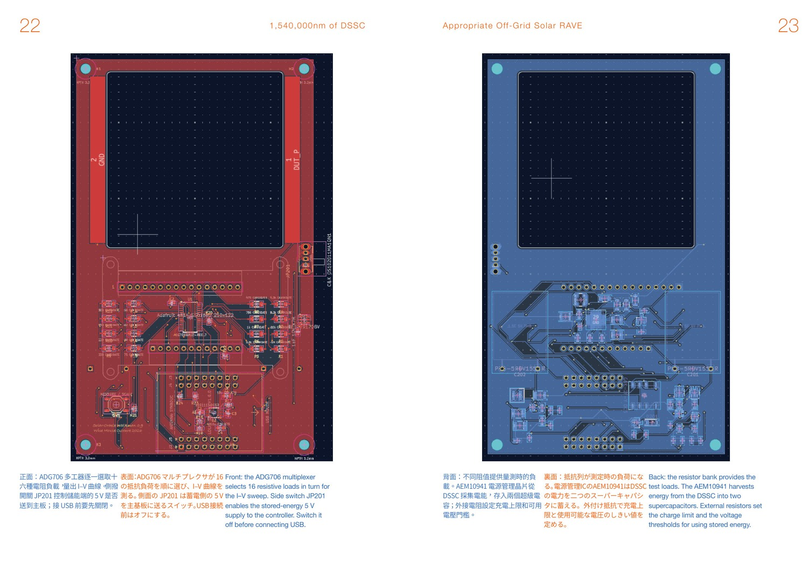

# 1,540,000nm of DSSC, Appropriate Off-Grid Solar RAVE

## 三語小誌 · The trilingual zines

施惟捷（Shih Wei-Chieh / Abao）｜中文・English・日本語｜104 × 147 mm

### Vol. 1 · 1,540,000nm of DSSC — 84 頁

從溫室走到工作桌：兩片導電玻璃如何經過染色、封裝與串聯，變成可以量測、可以發聲的太陽能電池？

[逐頁閱讀](book/vol-1/pages/) · [下載 DesignCraft 原檔](https://raw.githubusercontent.com/weiweiweiopen/dssc-rave/main/book/vol-1/DSSC-Vol-1.designcraft) · [圖版素材](book/vol-1/source-files/)

### Vol. 2 · 讀回同一片玻璃 — 58 頁

換了光線、重新裝夾，測量儀還認得那片手工玻璃嗎？從工作桌上的電流–電壓曲線，到 Solar Oracle Walkman 的聲音、記憶與代理許可。

[逐頁閱讀](book/vol-2/pages/) · [下載 DesignCraft 原檔](https://raw.githubusercontent.com/weiweiweiopen/dssc-rave/main/book/vol-2/DSSC-Vol-2.designcraft) · [圖版素材](book/vol-2/source-files/)

兩冊皆可在 DesignCraft 編輯，圖片已內嵌。`pages/` 為按頁碼排列的 240 dpi 閱讀圖（含白封底）；`source-files/` 是可替換的圖版素材。重排前請安裝授權字型，包括 Helvetica Neue、Noto Sans 的繁中與日文字型，以及 Kozuka Gothic Pr6N。各作品與圖版沿用原署名及授權。

Shih Wei-Chieh (Abao) · dye-sensitized solar glass, off-grid sound and a trilingual zine.

- [Fabrication and measurement](docs/fabrication.md) — baseline module and experimental variants, with source and reproducibility status.
- [Solar audio and RAVE](docs/audio.md) — signal paths and repeatable comparison procedure.
- [Bill of materials and dated price checks](materials/quotes.csv) · [pricing notes](materials/README.md).
- [Run sheet](templates/build-log.csv) · [I–V analysis](tools/iv.py).

The baseline is the documented 30 × 60 cm, 12-subcell Z-series glass prototype. Experimental variants are listed separately. This release documents a reproduction path; it does not claim independent reproduction or completeness where original masks, batches, waveforms, or settings are not available. Please contribute a filled build log and raw data when repeating a build.

The new guides, price data and templates are available under [CC BY 4.0](https://creativecommons.org/licenses/by/4.0/); the original booklet, artwork, and linked upstream assets retain their respective credits and terms. The analysis script is MIT-licensed as indicated in its source.
